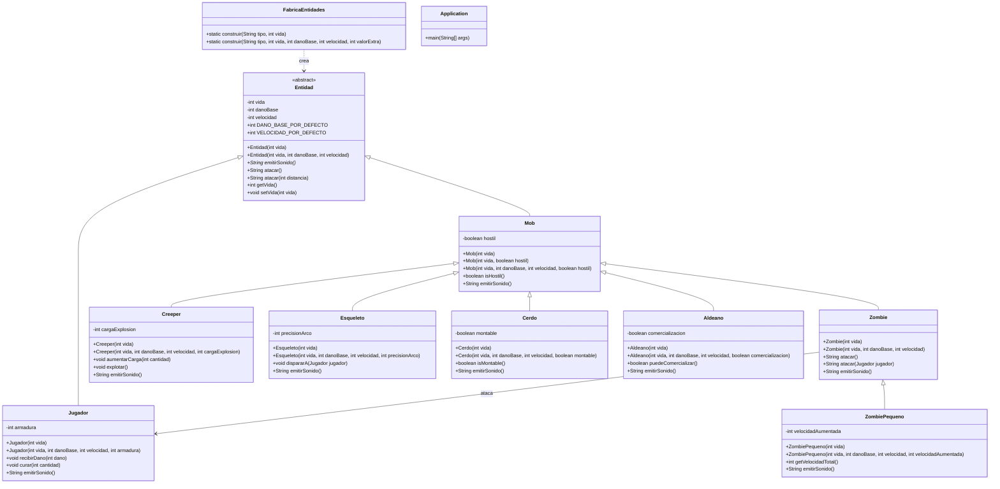

# rsantacruz-taller-git-2026

API REST del modelado de entidades de **Minecraft** (Lenguaje de Programación 3, edición 2026).
Ejercicio **POO-06**: paquetes, constructores, sobrecarga y sobreescritura.

**Commit de la solución:** [`84be129c56ed2cfef0fd97479a9a2b5d03fce5ee`](https://github.com/ruthsantacruzuca/rsantacruz-taller-git-2026/commit/84be129c56ed2cfef0fd97479a9a2b5d03fce5ee) — código, este README y `BITACORA.md` (el enlace también está en [`ESPECIFICACIONES-POO-06.md`](ESPECIFICACIONES-POO-06.md) y pegado en Classroom).

## Levantar

```bash
./mvnw spring-boot:run
```

Abre en `http://localhost:8080`.

| Endpoint | Qué hace |
|---|---|
| `GET /` | Confirma que el servicio está vivo |
| `GET /api/minecraft/construir?tipo=creeper&vida=20` | Construye con el **constructor simple** `construir(tipo, vida)` |
| `GET /api/minecraft/construir?tipo=creeper&vida=20&danoBase=6&velocidad=3&valorExtra=24&distancia=30` | Construye con el **constructor sobrecargado** de cinco argumentos y pide `atacar(distancia)` |
| `GET /api/minecraft/sonidos` | JSON con el sonido de cada hija, tratadas como `Entidad` (sin `if` por tipo) |

Si un valor rompe una regla, la clase lo rechaza y el controller informa `400` con el mensaje del dominio:

```bash
curl "http://localhost:8080/api/minecraft/construir?tipo=zombie&vida=-5"
# 400 {"error":"La vida no puede ser negativa: -5"}
```

---

## Sobrecarga y sobreescritura: qué cambió en este ejercicio

Son dos mecanismos distintos y conviene poder separarlos en una defensa oral.

### Sobrecarga — mismo nombre, otra lista de argumentos

La sobrecarga vive **en la misma clase**. Java elige la firma por la lista de argumentos en tiempo de compilación.

| Clase | Firmas sobrecargadas |
|---|---|
| `Entidad` | `Entidad(int vida)` y `Entidad(int vida, int danoBase, int velocidad)` |
| `Mob` | `Mob(int vida)`, `Mob(int vida, boolean hostil)` y `Mob(int vida, int danoBase, int velocidad, boolean hostil)` |
| `Zombie` | `Zombie(int vida)` y `Zombie(int vida, int danoBase, int velocidad)` |
| `Creeper`, `Esqueleto`, `ZombiePequeno`, `Jugador` | `Clase(int vida)` y la firma completa de cuatro argumentos |
| `Entidad` (mensaje de dominio) | `atacar()` y `atacar(int distancia)` |
| `FabricaEntidades` | `construir(tipo, vida)` y `construir(tipo, vida, danoBase, velocidad, valorExtra)` |

**Qué se agregó:** la firma simple de cada jerarquía delega con `this(...)` o `super(...)` en la completa, de modo que toda firma deja el objeto en un estado legal con valores por defecto (`DANO_BASE_POR_DEFECTO`, `VELOCIDAD_POR_DEFECTO`, `CARGA_EXPLOSION_POR_DEFECTO = 12`, `PRECISION_ARCO_POR_DEFECTO = 50`, `ARMADURA_POR_DEFECTO = 0`). La fábrica suma la segunda firma y el controller la expone por URL: si llegan `danoBase` y `velocidad` juntos usa la firma completa; si no llega ninguno de los dos, la simple.

**Se ve en la respuesta JSON**, en el campo `"constructor"`:

```json
{"constructor": "simple (construir(tipo, vida))", ...}
{"constructor": "sobrecargado (construir(tipo, vida, danoBase, velocidad, valorExtra))", ...}
```

### Sobreescritura — misma firma, implementación propia en la hija

La sobreescritura vive **entre la clase base y una hija**, con exactamente la misma firma; Java resuelve cuál código correr en tiempo de ejecución, según el objeto.

| Método de la base | Lo sobreescriben |
|---|---|
| `Entidad.emitirSonido()` *(abstracto)* | `Jugador`, `Mob`, `Zombie`, `Creeper`, `Cerdo`, `Aldeano`, `Esqueleto`, `ZombiePequeno` |
| `Entidad.atacar()` | `Zombie` (y por herencia cada hija decide) |

**Qué se agregó:** `Entidad.atacar()` y `Entidad.atacar(int distancia)` son métodos concretos nuevos; `Zombie` los sobreescribe con su propio texto (`"muerde con las dos manos…"`), mientras `Creeper` hereda el de `Entidad`. El controller pide `atacar()` a todas por el tipo padre y recibe textos distintos sin un solo `if` por tipo.

### Cómo distinguirlas en dos frases

- **Sobrecarga** → dos métodos con el mismo nombre **en la misma clase**; cambia la **lista de parámetros**; se decide al compilar. Acá la tienen `Entidad`, `Mob`, las hijas y `FabricaEntidades`.
- **Sobreescritura** → la hija **redefine** un método que ya existía en la base con **la misma firma**; se decide al ejecutar. Acá la tienen `emitirSonido()` (abstracto) y `atacar()`.

---

## Diagrama de clases (2 y 3 de septiembre, alineado con `src/`)



`*` = método abstracto. `<<abstract>>` = clase abstracta. Cada línea `+Clase(...)` lista **todas** las firmas de constructores (sobrecarga).

---

## Paquetes (template `lp3-template-tp`)

```text
src/main/java/py/edu/uc/lp3/
├── Application.java                 ← solo arranca el servicio
├── domain/                          ← la lógica del juego
│   ├── Entidad.java                 (abstracta: emitirSonido*, atacar / atacar(int))
│   ├── Mob.java
│   ├── Jugador.java
│   ├── Zombie.java
│   ├── ZombiePequeno.java
│   ├── Creeper.java
│   ├── Esqueleto.java
│   ├── Cerdo.java
│   ├── Aldeano.java
│   └── FabricaEntidades.java
└── rest/controller/                 ← solo entrada HTTP
    ├── IndexController.java         (GET /)
    ├── ConstruccionController.java  (GET /api/minecraft/construir)
    └── SonidoController.java        (GET /api/minecraft/sonidos)
```

El dominio no importa de Spring; los controllers no imponen reglas de negocio: **las reglas viven en las clases del dominio**.

## Encapsulamiento y respuesta a la pregunta de anclaje

*«¿Qué ocurre si el controller asigna a mano la vida o la munición?»*

No puede. Los atributos de `Entidad` son `private` y el controller sólo recibe `int` por URL: esos valores entran por el **constructor**, que valida antes de asignar (`vida >= 0`, `danoBase >= 0`, `velocidad >= 0`, `Jugador.vida <= 20`). No hay setters desde la capa HTTP que trabajen sobre un objeto ya construido; si el número es ilegal, la clase lanza `IllegalArgumentException`, el controller la traduce en `400` y **el objeto inválido nunca llega a existir**. La misma red vale para `atacar(int distancia)`: una distancia negativa no modifica nada, rechaza con el mensaje del dominio.

## Reglas de validación

| Clase | Regla |
|---|---|
| `Entidad` | vida, daño base y velocidad no negativos |
| `Entidad.atacar(int)` | distancia no negativa |
| `Jugador` | vida máxima 20; armadura no negativa |
| `Creeper` | carga de explosión no negativa; la carga sólo aumenta con valores positivos |
| `Esqueleto` | precisión de arco entre 0 y 100 |
| `ZombiePequeno` | velocidad aumentada no negativa |

## Conceptos de POO aplicados

- **Encapsulamiento:** atributos privados; el estado sólo cambia por constructores y mensajes que validan.
- **Herencia:** `Entidad → Mob → Zombie → ZombiePequeno`, `Entidad → Jugador`.
- **Sobrecarga:** constructores y `atacar()` / `atacar(int)`; dos firmas en la misma clase.
- **Sobreescritura:** `emitirSonido()` y `atacar()` redefinidos en las hijas.
- **Polimorfismo:** los controllers hablan con `Entidad`; el texto sale del método sobreescrito, sin `if` por tipo.
- **Clases abstractas:** `Entidad` declara lo que toda hija debe saber hacer.

## Cómo probar

```bash
./mvnw -q test          # 12 tests: constructores, sobrecarga, sobreescritura, esqueleto
./mvnw spring-boot:run
```

| Prueba | Resultado esperado |
|---|---|
| `GET /` | Mensaje de servicio vivo |
| `GET …/construir?tipo=creeper&vida=20` | `"constructor": "simple (construir(tipo, vida))"` con defectos |
| `GET …/construir?tipo=creeper&vida=20&danoBase=6&velocidad=3&valorExtra=24&distancia=30` | `"constructor": "sobrecargado (…)"`, daño 6 y ataque a distancia con daño reducido |
| `GET …/construir?tipo=zombie&vida=-5` | `400` con el error del dominio |
| `GET …/construir?tipo=zombie&vida=20&danoBase=4` | `400`: `danoBase` y `velocidad` van juntos o ninguno |
| `GET …/construir?tipo=zombie&vida=20&danoBase=4&velocidad=3&distancia=-1` | `400` por distancia negativa |
| `GET …/sonidos` | JSON con el sonido de cada hija, tratadas como `Entidad` |

## Bitácora de IA

Ver [`BITACORA.md`](BITACORA.md): asistente, modelo exacto y resumen de prompts.

## Licencia

Apache License 2.0 — ver [`LICENSE`](LICENSE).
